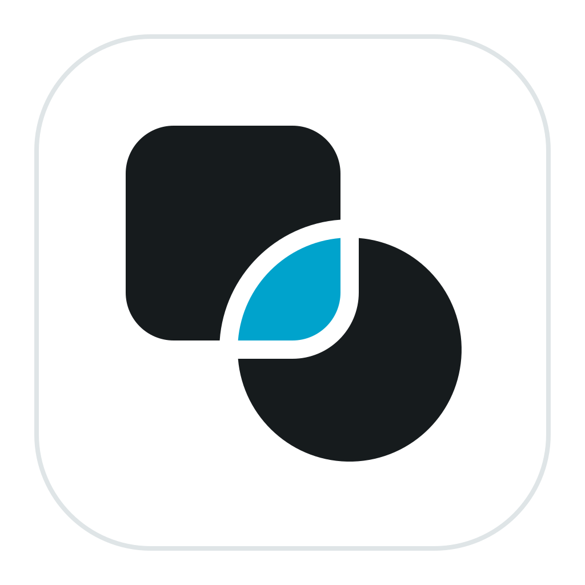
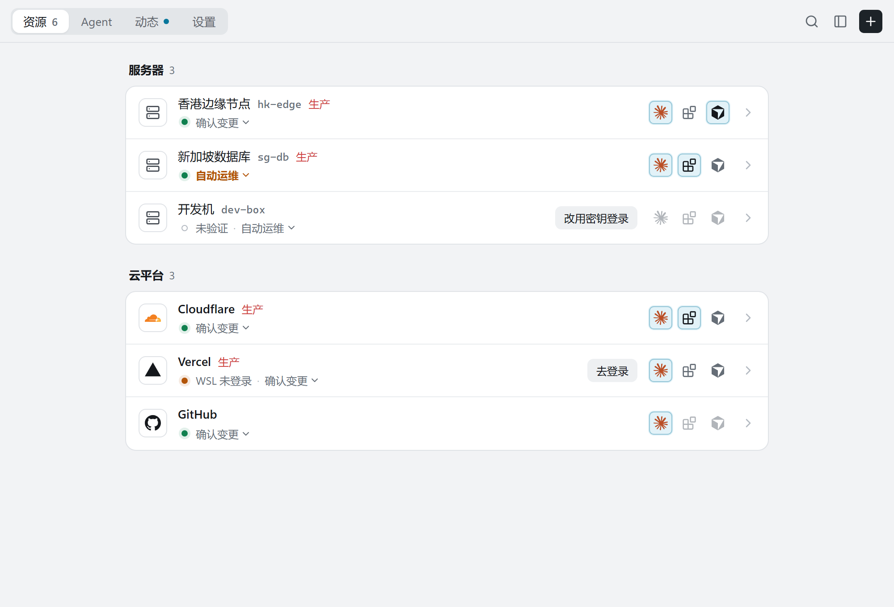
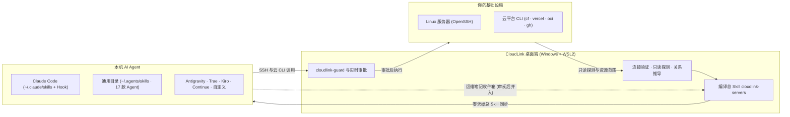
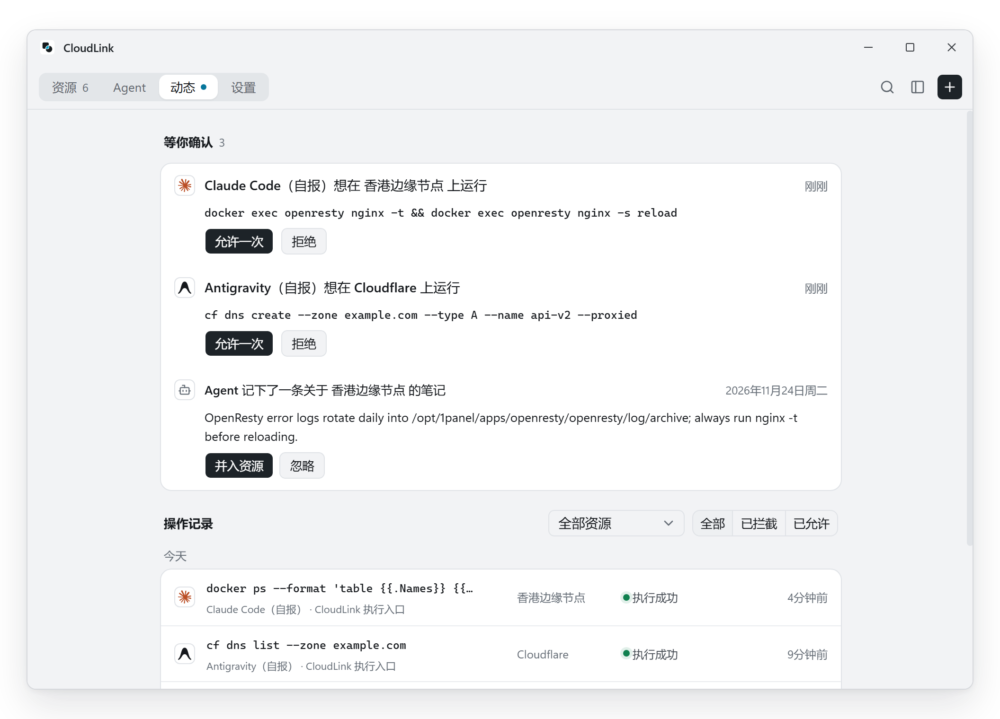
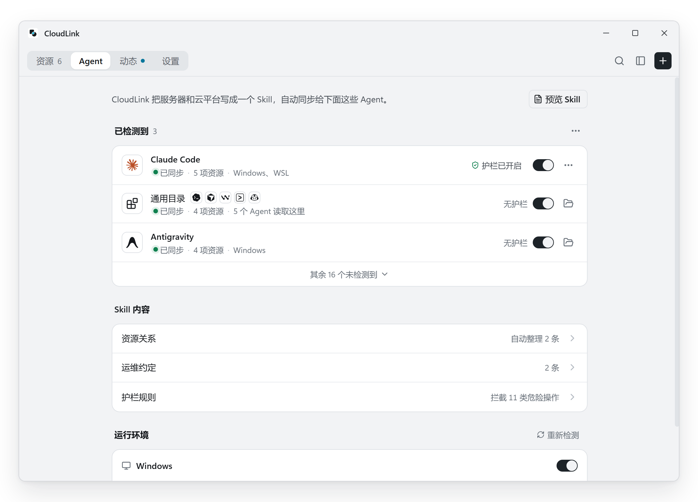
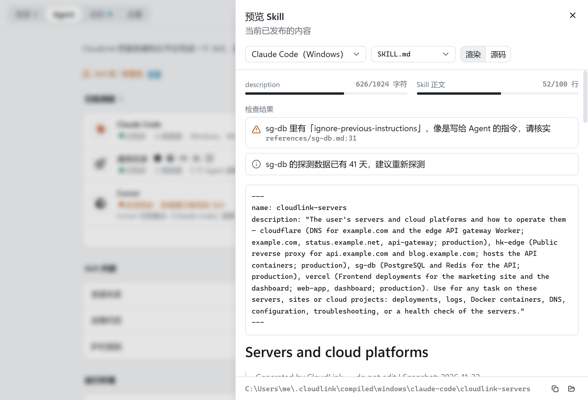

<div align="center">



<h1>CloudLink</h1>

<p><strong>面向 AI Agent 的本地基础设施接入与安全护栏。</strong></p>

<p>
  一次接入 SSH 服务器与主流云平台 CLI，编译为统一的总 Skill（<code>cloudlink-servers</code>），
  自动同步到 Windows 与 WSL2 下的 Claude Code、Codex、Cursor、Antigravity 等 20+ AI Agent；
  变更由你在桌面当面把关，Agent 摸清的运维经验确认后跨工具实时共享。
</p>

<p>
  <a href="https://github.com/Furina-he/cloudlink/releases/latest"></a>
  <a href="https://github.com/Furina-he/cloudlink/actions/workflows/ci.yml"></a>
  <a href="https://github.com/Furina-he/cloudlink/releases"></a>
  
  
  <a href="LICENSE"></a>
</p>

<p>
  <a href="README.md">English</a> · <strong>简体中文</strong>
</p>

<p>
  <a href="https://github.com/Furina-he/cloudlink/releases/latest">下载安装包</a> ·
  <a href="docs/releases/">版本说明</a> ·
  <a href="docs/architecture.md">架构说明</a> ·
  <a href="CONTRIBUTING.md">参与开发</a> ·
  <a href="https://github.com/Furina-he/cloudlink/issues">反馈问题</a>
</p>

<br />

<picture>
  <source media="(prefers-color-scheme: dark)" srcset="docs/assets/resources-dark.png" />
  <source media="(prefers-color-scheme: light)" srcset="docs/assets/resources-light.png" />
  
</picture>

</div>

---

## 为什么需要 CloudLink？

当你同时用多个 AI Agent 维护 VPS 与云平台资源时，往往会遇到三个反复出现的痛点：

- **上下文零散、反复解释** — 每换一个对话或切换 Agent，都要重新说明服务器别名、Docker 编排路径、域名指向和部署关系。
- **高风险命令缺乏刹车** — 把 SSH 和云 CLI 交给 Agent 后，一次误判的 `docker compose down -v`、`cf delete` 或 `cat .env` 就可能误删数据或泄露凭据。
- **运维经验无法跨工具复用** — Claude Code 踩坑摸清的配置路径与维护窗口，换到 Codex、Cursor 或 Antigravity 时又要从头摸索一遍。

**CloudLink 用一个安静的本地桌面窗口解决这些问题**：一次接入并验证服务器与云 CLI，勾选要提供给哪些 Agent，高风险变更在桌面「允许一次 / 拒绝」，Agent 记下的经验经你审阅后一键同步给所有已授权 Agent。

> [!NOTE]
> CloudLink **不是** SSH 终端、云平台控制台复刻，也不是操作系统级安全沙箱。它负责把准确的资源上下文、受管 Skill 分发与安全护栏交到本机 Agent 手里，真实访问权限仍由系统 OpenSSH、官方 CLI 和远端账号决定。

---

## 核心特性

- **统一基础设施接入** — 在同一视图管理 Linux SSH 服务器与 **Cloudflare（`cf`）**、**Vercel（`vercel`）**、**Oracle Cloud（`oci`）**、**GitHub（`gh`）**。支持导入现有 `~/.ssh/config` 别名，或通过密码自动转免密密钥、逐项核对主机指纹与只读探测完成接入。
- **云平台动态范围管理** — Cloudflare、Vercel、Oracle Cloud 和 GitHub 新接入均默认按绑定账号／归属**自动跟随当前及未来全部资源**，不再因预列举失败阻塞添加，同时支持稳定排除个别资源或切回手动选择（存量手动范围升级后不静默扩围）。
- **一份活的总 Skill（`cloudlink-servers`）** — 将已验证连接、只读探测摘要（Docker、systemd、1Panel、宝塔）、自动推导的资源关系（域名 → 服务器、跳板机、代码仓 → 部署）与运维约定整理为单一英文 Skill（`SKILL.md` + `references/*.md`），**不含任何密码、私钥或 API Secret**。
- **可预测的多 Agent 分发（Windows + WSL2）** — 自动识别 **23 款主流 AI Agent** 并支持自定义路径。点谁只改谁的选择，绝不悄悄联动其他 Agent；多 Agent 共用真实目录时仅写入明确选择的交集；写入前校验 `.cloudlink.json` 所有权、软链接与 Windows 重解析点，冲突支持备份接管与一键撤销。
- **本地安全护栏与桌面实时审批** — 所有已提供资源的 SSH 与云 CLI 操作统一经独立 `cloudlink-guard` Runner 执行（Claude Code 额外自动接管 `PreToolUse` Hook 拦截可识别直连）。支持「确认变更／自动运维」两档，并在「动态」视图实时审批。
- **跨 Agent 共享运维记忆（笔记收件箱）** — Agent 将排障学到的路径与注意事项写入 `~/.cloudlink/inbox/<资源>.md`。CloudLink 自动扫描疑似密钥（基于 gitleaks 规则）与提示词注入模式；你点一次并入，立刻重编译并同步给所有已授权 Agent。
- **本地优先的原生桌面体验** — 基于 Tauri v2 + Rust 构建。零账号、零遥测，支持浅色／深色主题、顶栏／侧栏导航切换、系统托盘常驻、开机自启与基于 minisign 签名的应用内更新。

---

## 工作原理



---

## 执行档位与护栏策略

所有新资源默认处于 **确认变更** 档；任意资源切到 **自动运维** 时均会弹出轻确认，避免误开自动执行权限。

| 操作类别 | 典型示例 | `确认变更`（默认） | `自动运维` |
| :--- | :--- | :---: | :---: |
| **只读巡检与查询** | `df -h`、`docker ps`、`nginx -t`、`cf zones list`、`vercel ls`、`oci … get` | 直接执行 | 直接执行 |
| **常规变更** | `nginx -s reload`、`docker compose up -d`、`cf dns create`、常规发布 | **等你确认（允许一次）** | 直接执行 |
| **高风险操作** | 删除数据／卷（`docker compose down -v`、`dropdb`）、销毁云资源、重启或关机、改防火墙、改 SSH／`sshd` 配置、关键服务、内容不可见脚本（`curl \| sh`） | **等你确认（允许一次）** | **等你确认（允许一次）** |
| **硬红线（不可放行）** | 读取 `.env` / `*.pem` / `id_*` / `/etc/shadow`、`docker inspect` 环境变量、`vercel env pull`、`cf` 导出凭据、删除 GitHub 仓库、强推默认分支、跨账号或目标不明 | **直接拒绝** | **直接拒绝** |

- **单次审批机制**：待确认命令暂停在 **动态 → 等你确认**（允许一次 / 拒绝）。审批票据自创建起 5 分钟过期、最多消费一次，并在真正启动子进程前再次核对路由与策略版本。
- **如实归因调用来源**：操作记录区分实际调用 Agent（`--agent` 自报或 Hook 身份）、检查通道（Runner / Hook）与真实退出状态；未知来源绝不按分发目录猜测品牌。

---

## 支持生态

### 基础设施与云平台 CLI

| 资源类型 | 工具 / 协议 | 接入与范围说明 |
| :--- | :--- | :--- |
| **Linux 服务器** | 系统 `OpenSSH` | 支持导入 `~/.ssh/config` 或受管接入；密码自动转免密密钥；逐项核对主机指纹；经同意安全 `Include`；固定只读 POSIX `sh` 探测 |
| **Cloudflare** | 官方新版 `cf` CLI | 一键后台安装并由 CLI 打开浏览器授权（需 Node.js 22.23+）；默认自动跟随域名、Workers 与 Pages，支持按项排除 |
| **Vercel** | `vercel` CLI | 一键后台安装与浏览器登录；默认自动跟随当前及未来项目，支持按项排除或手选 |
| **Oracle Cloud** | `oci` CLI | 保留可见终端向导完成 `oci setup bootstrap`；动态跟随区隔与计算实例 |
| **GitHub** | `gh` CLI | 按选定个人账号或组织独立接入；一键安装与浏览器登录；默认自动跟随当前及未来有权访问的仓库（含私有），支持稳定仓库 ID 排除 |

### 支持的 AI Agent（内置识别 23 款 + 自定义目录）

| 分发目标 | 全局 Skills 路径 | 涵盖 Agent 与能力 |
| :--- | :--- | :--- |
| **Claude Code** | `~/.claude/skills` | 同步总 Skill + 自动配置 `PreToolUse` Bash 命令护栏钩子，拦下可识别直连并引导走 Runner |
| **通用共享目录** | `~/.agents/skills` | 一次同步覆盖 **17** 款内置识别 Agent：**Codex**、**Cursor**、**Windsurf**、**Gemini CLI**、**GitHub Copilot**、**OpenCode**、**Cline**、**Roo Code**、**Kilo Code**、**Goose**、**Amp**、**Qwen Code**、**Droid**、**Augment**、**Crush**、**Junie**、**Warp** |
| **Antigravity** | `~/.gemini/config/skills` | 自动探测，桌面版 / IDE 与 `agy` CLI 共用 |
| **独立目录（自动探测）** | `~/.trae/skills`、`~/.trae-cn/skills`、`~/.kiro/skills`、`~/.continue/skills` | 在 Windows 或 WSL2 检测到 **Trae**、**Trae CN**、**Kiro**、**Continue** 后自动加入 |
| **自定义目录** | 任意 Windows / WSL2 路径 | 手动登记任意本地 skills 目录，同样享有所有权校验与备份保护 |

---

## 界面预览

### 实时命令审批与 Agent 笔记收件箱

在同一页面处理待确认变更命令的「允许一次 / 拒绝」、一键将 Agent 运维笔记并入总 Skill，并查看跨 Agent 的完整执行记录。

<div align="center">
<picture>
  <source media="(prefers-color-scheme: dark)" srcset="docs/assets/activity-dark.png" />
  <source media="(prefers-color-scheme: light)" srcset="docs/assets/activity-light.png" />
  
</picture>
</div>

### Agent 分发与编译产物预览

<table>
  <tr>
    <td width="50%" valign="top">
      <p align="center"><strong>Agent 分发目标、护栏状态与 Skill 内容</strong></p>
      <picture>
        <source media="(prefers-color-scheme: dark)" srcset="docs/assets/agents-dark.png" />
        <source media="(prefers-color-scheme: light)" srcset="docs/assets/agents-light.png" />
        
      </picture>
    </td>
    <td width="50%" valign="top">
      <p align="center"><strong>编译后的 <code>SKILL.md</code> 实时预览与文件树</strong></p>
      <picture>
        <source media="(prefers-color-scheme: dark)" srcset="docs/assets/skill-preview-dark.png" />
        <source media="(prefers-color-scheme: light)" srcset="docs/assets/skill-preview-light.png" />
        
      </picture>
    </td>
  </tr>
</table>

---

## 快速开始

### 运行环境要求

- **操作系统**：Windows 10 / 11（x64），需要 WebView2 Runtime
- **SSH**：系统内置 OpenSSH 客户端
- **可选依赖**：使用 WSL 内 Agent 时需要 WSL2；使用 Cloudflare `cf` CLI 需要 Node.js 22.23 或更高版本

### 安装与使用

1. 从 [**GitHub Releases**](https://github.com/Furina-he/cloudlink/releases/latest) 下载 `CloudLink_<版本号>_x64-setup.exe` 并安装。
2. 点击右上角 **`+`** 添加 SSH 服务器（也可直接从 `~/.ssh/config` 导入），或一键安装并登录 Cloudflare、Vercel、Oracle Cloud、GitHub CLI。
3. 按引导核对主机指纹并同意 SSH 配置 `Include`，完成连接验证。
4. 在资源行直接点选要提供给哪些 Agent，随后让 Agent 执行具体任务（例如“检查服务器磁盘占用”），遇到变更时在 CloudLink 桌面端把关。

---

## 安全边界与设计承诺

开发者工具的信任来自把能力与边界都写在明面上：

| CloudLink 负责做好这些 | CloudLink 明确不冒充这些 |
| :--- | :--- |
| **Skill 零凭据**：密码、私钥内容与云 API Token 绝不写入 `SKILL.md` 或 `references/*.md`。 | **不是操作系统级安全沙箱**：同一系统用户下，Agent 通过其他本地工具或绕过 Runner 的不可识别直连不由 CloudLink 提供隔离边界。 |
| **运行中含托盘持续检查**：关闭窗口留在系统托盘时，Runner 检查、审批卡片与完整调用来源记录持续工作。 | **彻底退出后停止检查与审批**：彻底退出后，已分发 Skill、独立 Runner 与手动 `ssh <别名>` 仍可用，但模式检查与审批会停止；未启动的旧审批不会因退出而自动获批。 |
| **只动受管内容**：覆盖或删除前均校验 `.cloudlink.json` 所有权、软链接与 Windows 重解析点，接管冲突自动备份并支持撤销。 | **不做虚假远端回滚**：文件接管与笔记并入支持撤销；已经发往远端主机执行的命令如实记录退出结果，绝不用撤销按钮伪装回滚副作用。 |
| **本地优先、零遥测**：全部数据保存在本地 SQLite，无账号登录与云端同步；联网仅限你主动发起的连接、探测、CLI 查询与可关闭的签名更新检查。 | **不替代远端最小权限**：护栏用于降低误操作风险，不能替代低权限账号、IAM 范围限制或系统隔离。 |

完整协议、私有路由校验与隔离边界见 [docs/architecture.md](docs/architecture.md)。

---

## 从源码运行

仅预览前端界面（Mock 模式使用演示数据，无需安装 Rust 工具链）：

```bash
git clone https://github.com/Furina-he/cloudlink.git
cd cloudlink
pnpm install --frozen-lockfile
pnpm dev:mock
```

运行完整 Tauri 桌面应用（需要 Rust 1.95.0+、MSVC 构建工具与 Node.js 22+）：

```bash
pnpm build:guard
pnpm tauri dev
```

完整开发环境配置、测试隔离要求与检查命令见 [CONTRIBUTING.md](CONTRIBUTING.md)。

### 技术栈

- **桌面端与后端**：Tauri v2 · Rust · SQLite · `cloudlink-guard` sidecar · minisign 签名更新
- **前端界面**：React 19 · TypeScript · Vite · Tailwind CSS v4 · shadcn/ui（`base-nova`）· Zustand · Motion

---

## 路线图

- [x] Windows 10/11 + WSL2 的 SSH 与四大云平台 CLI（`cf` / `vercel` / `oci` / `gh`）统一接入与动态范围管理
- [x] `cloudlink-servers` 总 Skill 编译器与 23 款主流 AI Agent（含 Antigravity）受管分发
- [x] `cloudlink-guard` 独立执行通道、确认变更／自动运维两档、桌面实时审批与 Agent 笔记收件箱
- [ ] macOS 桌面端支持
- [ ] Linux 桌面端支持
- [ ] 为 Claude Code 之外的更多 AI Agent 提供原生 Hook 护栏集成

---

## 工程文档

| 文档 | 内容说明 |
| :--- | :--- |
| [CONTRIBUTING.md](CONTRIBUTING.md) | 开发环境、测试隔离规则、检查命令与提交规范 |
| [docs/architecture.md](docs/architecture.md) | 模块职责、数据流、Runner 协议与安全边界 |
| [docs/code-standards.md](docs/code-standards.md) | 前端、Rust、类型契约（`ts-rs`）与测试规范 |
| [docs/design-system.md](docs/design-system.md) | 「安静钢面」视觉令牌、组件映射与交互约定 |
| [docs/releases/README.md](docs/releases/README.md) | 版本号、minisign 签名、CI 流水线与 GitHub Releases 流程 |
| [THIRD_PARTY_NOTICES.md](THIRD_PARTY_NOTICES.md) | 第三方许可与声明（含 gitleaks 密钥检测规则） |

---

## 许可证

CloudLink 使用 [MIT 许可证](LICENSE) 开源。第三方材料保留各自原有许可，详见 [THIRD_PARTY_NOTICES.md](THIRD_PARTY_NOTICES.md)。
